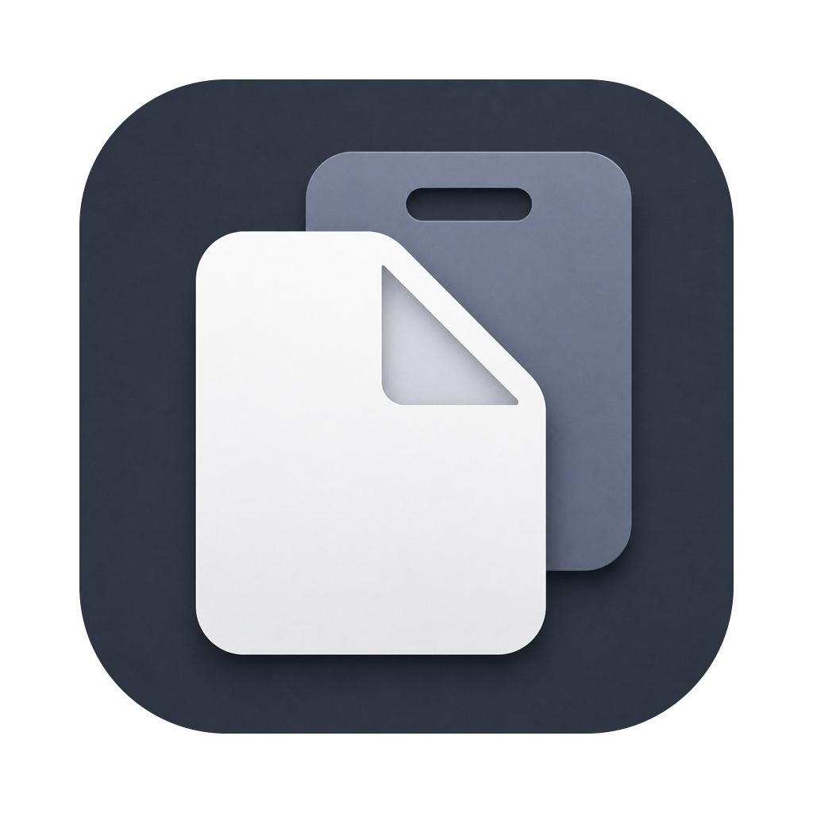

<div align="center">
  
  <h1>Simple Clipboard</h1>
  <p><strong>Un gestor de historial de portapapeles y snippets para macOS.</strong></p>
  <p>
    
    
    
    
  </p>
  <p>🇬🇧 <a href="README.md">Read in English</a></p>
</div>

---

Simple Clipboard vive en tu barra de menús y recuerda todo lo que copias (texto, código, enlaces, imágenes, colores, archivos y PDFs) para que puedas volver a pegarlo cuando lo necesites. También guarda **snippets**: fragmentos reutilizables de texto o archivos, organizados en carpetas a un atajo de distancia.

Construido de forma nativa para macOS 26 con SwiftUI.

## Instalación

Descarga el último `.dmg` desde la [página de Releases](https://github.com/juancarloslopez3/simple-clipboard/releases), ábrelo y arrastra **Simple Clipboard** a tu carpeta Aplicaciones.

Simple Clipboard es un agente de barra de menús — tras arrancar, búscalo en la barra de menús, no en el Dock.

> [!IMPORTANT]
> La app está firmada localmente y no con un certificado de pago de Apple Developer, así que macOS bloquea el primer arranque. Para permitirlo: abre **Ajustes del Sistema → Privacidad y seguridad**, baja hasta el aviso sobre Simple Clipboard y pulsa **Abrir de todos modos**. Solo hay que hacerlo una vez por versión.

## Características

- **Historial de portapapeles** — cada copia se captura y clasifica automáticamente: texto plano, texto con formato, código, URLs, imágenes, colores, archivos y PDFs.
- **Panel flotante** — pulsa <kbd>⌘⇧V</kbd> desde cualquier app para buscar y navegar tu historial en un panel; <kbd>⌘⇧B</kbd> abre tus snippets. Selecciona un elemento para copiarlo y pégalo cuando desees.
- **Selección múltiple en el panel** — mantén <kbd>⌘</kbd> y haz clic en varios elementos, o en una carpeta para elegir todo su contenido. Suelta <kbd>⌘</kbd> para copiarlos todos (<kbd>Esc</kbd> borra la selección). Al pegarlos en Finder, todo su texto queda en un único `.txt` (un `.rtf` si alguno tiene formato), en el orden en que lo elegiste, junto a las imágenes, PDFs y archivos.
- **Vista previa estilo Quick Look** — pon el cursor sobre un elemento y toca <kbd>Espacio</kbd> para una vista previa completa: texto desplazable (el texto con formato se muestra como texto plano, con sus tabulaciones, sangrías y listas), imágenes y PDFs con zoom (pellizca, usa los controles de zoom o <kbd>⌘</kbd><kbd>+</kbd> / <kbd>⌘</kbd><kbd>−</kbd> / <kbd>⌘</kbd><kbd>0</kbd>), archivos de Word y PowerPoint como páginas que puedes alejar para verlas enteras, hojas de Excel y CSV con sus pestañas, invitaciones de calendario (`.ics`) como tarjetas de evento, muestras de color y vista previa nativa de archivos. ¿Copiaste varios archivos? Desliza con dos dedos o pulsa <kbd>←</kbd> <kbd>→</kbd> para pasar de uno a otro. Mantén <kbd>Espacio</kbd> para echar un vistazo y suéltalo para cerrar, igual que en Finder.
- **Snippets** — guarda cualquier elemento del historial como snippet reutilizable (<kbd>⌘S</kbd> en el panel mientras el cursor está encima del elemento que quieres guardar, o en la ventana principal sobre una o varias filas seleccionadas), organízalos en carpetas y edítalos en el editor integrado. Snippets de texto plano, texto con formato y archivos.
- **Pegado como texto plano** — un ajuste *pegar siempre como texto plano*, además de <kbd>⌥</kbd>-clic sobre cualquier elemento para invertir el modo al vuelo.
- **Deduplicación** — cuando copias algo reciente, el elemento se mueve al principio del historial en lugar de duplicarse y llenar tu historial de elementos duplicados (solo para los 10 primeros elementos).
- **Ventana principal** — un navegador completo con filtros por tipo (Texto plano · Con formato · URL · Código · Imagen · PDF · Archivo), búsqueda y tu biblioteca de snippets, todo en un mismo lugar.
- **Tutorial de bienvenida** — una breve introducción animada enseña los gestos ocultos en el primer arranque. El tutorial se puede ver de nuevo desde ajustes -> general.

## Privacidad

- **Todo se queda en tu Mac.** El historial se guarda localmente con SwiftData, sin red, sin analíticas, sin cuentas.
- **Apps ignoradas** — excluye gestores de contraseñas o cualquier app de la captura.
- **Límites de tamaño y retención** — limita el tamaño de los elementos capturados, elige cuántos conservar y, opcionalmente, borra el historial al salir.

## Atajos de teclado

| Acción | Atajo |
|---|---|
| Abrir el panel de historial | <kbd>⌘⇧V</kbd> |
| Abrir el panel de snippets | <kbd>⌘⇧B</kbd> |
| Guardar como snippet: el elemento bajo el cursor (panel) o los elementos seleccionados (ventana principal) | <kbd>⌘S</kbd> |
| Vista previa del elemento (toque para fijar, mantener para ojear) | <kbd>Espacio</kbd> |
| Copiar invirtiendo el modo de texto plano | <kbd>⌥</kbd>-clic |
| Seleccionar varios elementos en el panel, o una carpeta entera; suelta <kbd>⌘</kbd> para copiarlos | <kbd>⌘</kbd>-clic |
| Pegar elemento anterior · Pegar como texto plano · Borrar historial | Configurables en Ajustes |

## Compilar desde el código fuente

Requiere **macOS 26+** y **Xcode 26+**.

```bash
brew install xcodegen        # solo la primera vez
xcodegen generate            # genera Simple Clipboard.xcodeproj
open "Simple Clipboard.xcodeproj"   # después ⌘R en Xcode
```

O compila desde la terminal:

```bash
xcodebuild -project "Simple Clipboard.xcodeproj" -scheme "Simple Clipboard" -destination 'platform=macOS' build
```

Simple Clipboard es un agente de barra de menús (`LSUIElement`) — tras arrancar, búscalo en la barra de menús, no en el Dock.

## Arquitectura

- **SwiftUI primero**, con AppKit (`NSPasteboard`, `NSPanel`, monitores `NSEvent`) aislado detrás de servicios.
- **Concurrencia estricta de Swift 6** — todo lo que toca AppKit, el portapapeles o SwiftData es `@MainActor`.
- Persistencia con **SwiftData**: tipos `@Model` (`ClipboardItem`, `Snippet`, `SnippetFolder`) y vistas dirigidas por `@Query`.
- **Servicios `@Observable`** compuestos por un único `AppModel` raíz, propiedad del delegado de la app e inyectado en cada escena.
- Proyecto generado con **XcodeGen** (`project.yml` es la fuente de verdad).

## Licencia

Simple Clipboard se distribuye bajo la [licencia MIT](LICENSE).

---

<div align="center">Hecho por <a href="https://github.com/juancarloslopez3">Juan Carlos López</a></div>
