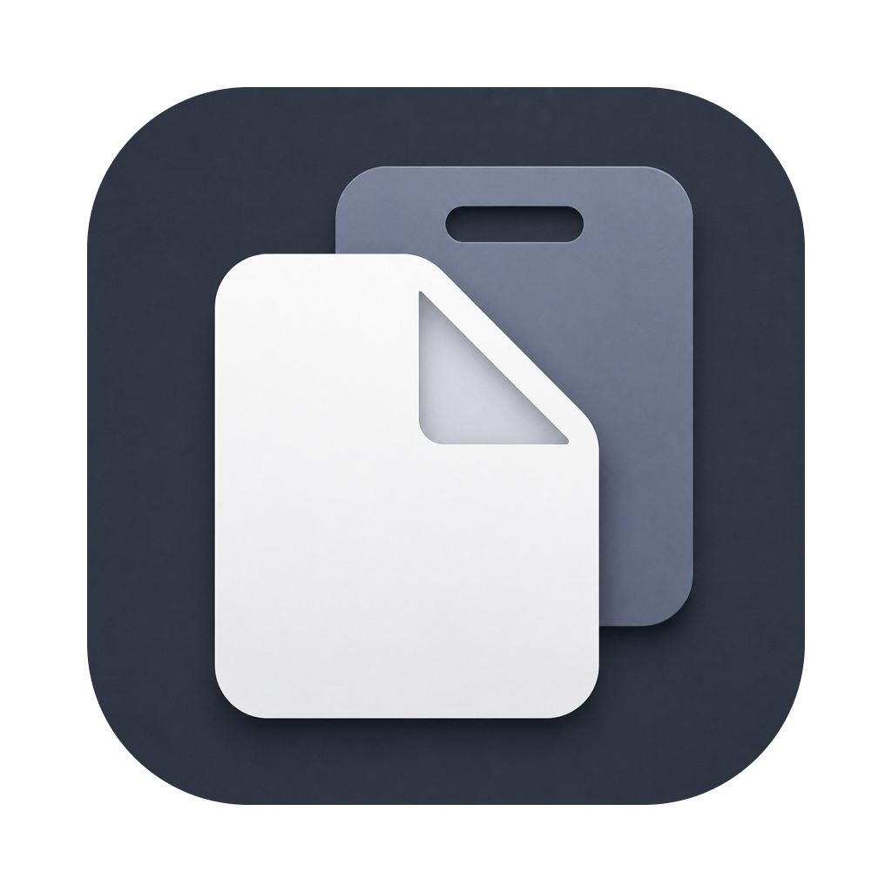

<div align="center">
  
  <h1>Simple Clipboard</h1>
  <p><strong>A simple clipboard history & snippets manager for macOS.</strong></p>
  <p>
    
    
    
    
  </p>
  <p>🇪🇸 <a href="README.es.md">Leer en español</a></p>
</div>

---

Simple Clipboard lives in your menu bar and remembers everything you copy (text, code, links, images, colors, files, and PDFs) so you can paste it again whenever you need it. It also keeps **snippets**: reusable pieces of text or files, organized in folders, always one shortcut away.

Built natively for macOS 26 with SwiftUI language.

## Install

Download the latest `.dmg` from the [Releases page](https://github.com/juancarloslopez3/simple-clipboard/releases), open it, and drag **Simple Clipboard** into your Applications folder.

Simple Clipboard is a menu-bar agent — after launch, look for it in the menu bar, not the Dock.

> [!IMPORTANT]
> The app is signed locally rather than with a paid Apple Developer certificate, so macOS blocks the first launch. To allow it: open **System Settings → Privacy & Security**, scroll down to the notice about Simple Clipboard, and click **Open Anyway**. You only need to do this once per version.

## Features

- **Clipboard history** — every copy is captured and typed automatically: plain text, rich text, code, URLs, images, colors, files, and PDFs.
- **Floating panel** — press <kbd>⌘⇧V</kbd> anywhere to search and browse your history in a panel; <kbd>⌘⇧B</kbd> opens your snippets. Select an item to copy it, then paste as usual.
- **Quick Look previews** — hover an item and tap <kbd>Space</kbd> for a full preview: scrollable text, rendered rich text, zoomable images and PDFs (pinch to zoom), color swatches, and native file previews. Hold <kbd>Space</kbd> to peek, release to close, just like Finder.
- **Snippets** — save anything from your history as a reusable snippet (<kbd>⌘S</kbd> in the panel while hovering the item you want to save), organize them in folders, and edit them in the integrated editor. Plain text, rich text, and file snippets.
- **Plain-text pasting** — an *always paste plain text* mode, plus <kbd>⌥</kbd>-click on any item to invert the mode on the fly.
- **Deduplication** — re-copying something recent bumps it back to the top instead of cluttering your history (only for the 10 first items).
- **Main window** — a full browser with type filters (Plain Text · Rich Text · URL · Code · Image · PDF · File), search, and your snippet library side by side.
- **Onboarding tour** — a short animated intro teaches the hidden gestures on first launch. You can repeat this tour in settings -> general.

## Privacy

- **Everything stays on your Mac.** History is stored locally with SwiftData, no network, no analytics, no accounts.
- **Ignored apps** — exclude password managers or any app from capture.
- **Size limits & retention** — cap captured item size, choose how many items to keep, and optionally clear history on quit.

## Keyboard shortcuts

| Action | Shortcut |
|---|---|
| Open clipboard history panel | <kbd>⌘⇧V</kbd> |
| Open snippets panel | <kbd>⌘⇧B</kbd> |
| Save hovered item as a snippet (in panel / main window) | <kbd>⌘S</kbd> |
| Preview hovered item (tap to pin, hold to peek) | <kbd>Space</kbd> |
| Copy with plain-text mode inverted | <kbd>⌥</kbd>-click |
| Paste previous item · Paste as plain text · Clear history | Configurable in Settings |

## Building from source

Requires **macOS 26+** and **Xcode 26+**.

```bash
brew install xcodegen        # one-time
xcodegen generate            # generates Simple Clipboard.xcodeproj
open "Simple Clipboard.xcodeproj"   # then ⌘R in Xcode
```

Or build from the command line:

```bash
xcodebuild -project "Simple Clipboard.xcodeproj" -scheme "Simple Clipboard" -destination 'platform=macOS' build
```

Simple Clipboard is a menu-bar agent (`LSUIElement`) — after launch, look for it in the menu bar, not the Dock.

## Architecture

- **SwiftUI-first**, with AppKit (`NSPasteboard`, `NSPanel`, `NSEvent` monitors) isolated behind services.
- **Swift 6 strict concurrency** — everything touching AppKit, the pasteboard, or SwiftData is `@MainActor`.
- **SwiftData** persistence with `@Model` types (`ClipboardItem`, `Snippet`, `SnippetFolder`) and `@Query`-driven views.
- **`@Observable` services** composed by a single root `AppModel`, owned by the app delegate and injected into every scene.
- **XcodeGen** project generation (`project.yml` is the source of truth).

---

<div align="center">Made by <a href="https://github.com/juancarloslopez3">Juan Carlos López</a></div>
